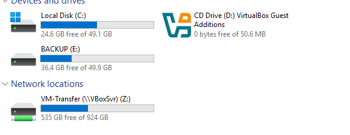
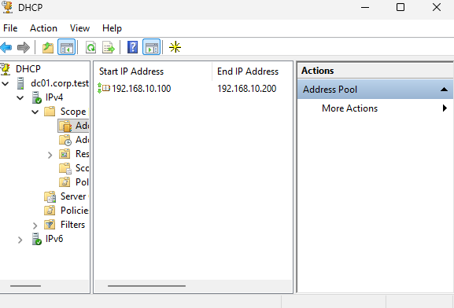
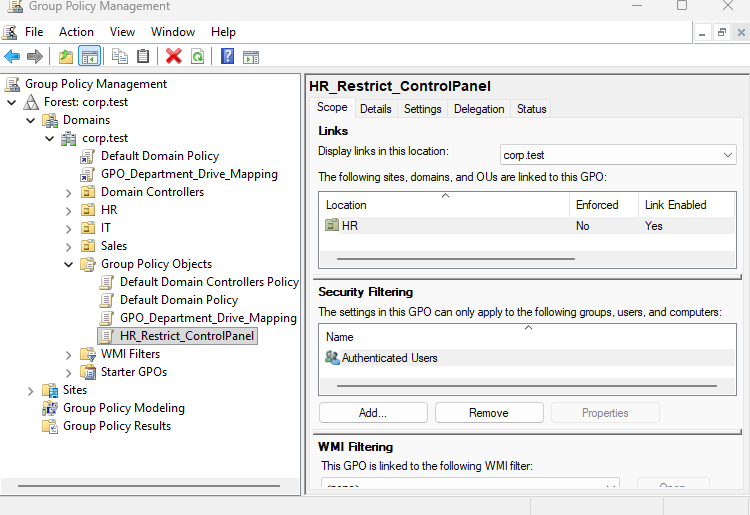
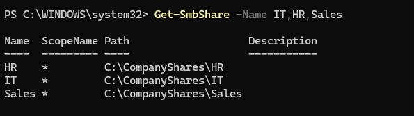
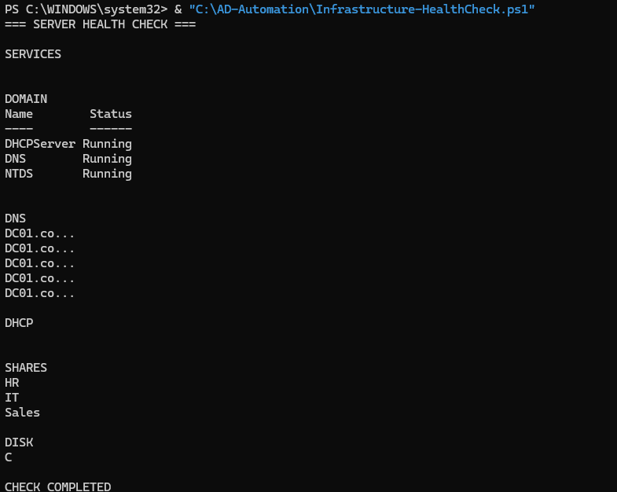

# Windows Server 2025 — Enterprise Infrastructure Lab

**Active Directory | DNS | DHCP | Group Policy | File Server | PowerShell Automation**

A hands-on enterprise infrastructure lab built with Windows Server 2025, Windows 11 Pro, and Oracle VirtualBox.

This project simulates a small business IT environment and demonstrates practical skills in Windows Server administration, identity management, networking, access control, troubleshooting, and PowerShell scripting.

## Project Overview

The lab consists of a Windows Server 2025 Domain Controller and a Windows 11 Pro domain-joined workstation.

It was designed to practice common tasks performed by IT Support Technicians and Junior System Administrators, including:

- Managing Active Directory users, groups, and Organizational Units.
- Configuring DNS and DHCP services.
- Applying Group Policy settings.
- Managing departmental file shares and permissions.
- Troubleshooting domain connectivity and access issues.
- Automating administrative tasks with PowerShell.
- Configuring Windows Server Backup.

## Lab Architecture

| Component | Configuration |
|---|---|
| Hypervisor | Oracle VirtualBox |
| Domain Controller | DC01 — Windows Server 2025 |
| Client Workstation | CLIENT02 — Windows 11 Pro |
| Active Directory Domain | `corp.test` |
| Internal Network | `192.168.10.0/24` |
| DC01 Internal IP | `192.168.10.10` |
| DNS Server | `192.168.10.10` |
| DHCP Pool | `192.168.10.100–192.168.10.200` |

Both virtual machines use an internal VirtualBox network for domain communication and a NAT adapter for external connectivity.

For more details, see [Network Architecture](documentation/network-architecture.md).

## Implemented Features

### 1. Active Directory Domain Services

- Installed and configured Active Directory Domain Services.
- Promoted DC01 to a Domain Controller.
- Created the `corp.test` domain.
- Organized users into departmental Organizational Units.
- Created security groups for IT, HR, and Sales.
- Joined CLIENT02 to the domain.
- Tested domain authentication and connectivity.

**Departmental security groups:**

| Department | Security Group |
|---|---|
| IT | `GG_IT` |
| Human Resources | `GG_HR` |
| Sales | `GG_Sales` |



### 2. DNS and DHCP Configuration

Configured DNS and DHCP services to support the internal corporate network.

**DNS:**
- Internal domain name resolution.
- Domain Controller discovery through DNS SRV records.
- DNS troubleshooting using PowerShell and Windows utilities.

**DHCP:**
- IPv4 scope configuration.
- Automatic client address assignment.
- DNS server and domain suffix distribution.
- DHCP troubleshooting and client lease renewal.



### 3. Group Policy Management

Implemented departmental policies through Group Policy Management.

Key configurations include:

- HR Control Panel restrictions.
- Automatic network drive mapping.
- Group Policy Preferences.
- Security group-based item-level targeting.

**Drive mappings:**

| Department | Drive Letter | Network Share |
|---|---|---|
| IT | `I:` | `\\dc01.corp.test\IT` |
| HR | `H:` | `\\dc01.corp.test\HR` |
| Sales | `S:` | `\\dc01.corp.test\Sales` |

Validated policy application and drive mapping using domain user accounts.



### 4. File Server and Access Control

Configured departmental shared folders on DC01:

- `C:\CompanyShares\IT`
- `C:\CompanyShares\HR`
- `C:\CompanyShares\Sales`

Implemented:

- SMB file shares.
- NTFS access permissions.
- Department-based access control.
- Security group-based authorization.
- Authorized and unauthorized access testing.

Verified that users could access their assigned departmental resources while access to restricted resources was denied.



### 5. Backup and Recovery

Installed Windows Server Backup and configured a dedicated virtual backup disk.

The lab includes:

- File backup configuration.
- File recovery procedures.
- System State backup exercises.
- Study of Active Directory disaster recovery concepts.

Backup configuration and recovery testing are documented separately. Successful recovery should only be claimed when the corresponding test has been verified.

### 6. PowerShell Automation

Created PowerShell scripts to automate administrative tasks.

**[Create-ADUsers.ps1](scripts/Create-ADUsers.ps1)**

CSV-based Active Directory user provisioning, including:

- Department-based OU selection.
- User existence checks.
- Temporary password handling.
- Account activation.
- Security group membership management.

**[Infrastructure-HealthCheck.ps1](scripts/Infrastructure-HealthCheck.ps1)**

A lightweight infrastructure diagnostic script covering:

- Windows Server services.
- Active Directory domain information.
- DNS resolution.
- DHCP scope information.
- SMB shares.
- Disk space.



## Troubleshooting Experience

During the project, several practical troubleshooting scenarios were investigated.

| Issue | Troubleshooting Approach |
|---|---|
| Domain connectivity | Verified DNS configuration and DC discovery |
| DHCP configuration | Checked scopes, adapters, and client leases |
| Group Policy application | Used `gpupdate` and `gpresult` |
| File share access | Reviewed NTFS and SMB permissions |
| AD provisioning failures | Investigated password policies and disabled accounts |
| PowerShell parser errors | Simplified and corrected script syntax |

See [Troubleshooting Documentation](documentation/troubleshooting.md) for additional details.

## Validation and Testing

The environment was tested using tools and commands such as:

```powershell
dcdiag /test:Advertising
Resolve-DnsName dc01.corp.test -Server 192.168.10.10
Get-DhcpServerv4Scope
Get-SmbShare -Name IT,HR,Sales
Get-ADUser -Identity nioannou -Properties Enabled
gpresult /r
```

Documented results are available in [Test Results](documentation/test-results.md).

## Repository Structure

```text
windows-server-2025-enterprise-lab/
├── README.md
├── scripts/
│   ├── Create-ADUsers.ps1
│   └── Infrastructure-HealthCheck.ps1
├── screenshots/
│   ├── active-directory.png
│   ├── dhcp-scope.png
│   ├── group-policy.png
│   ├── file-shares.png
│   └── health-check.png
└── documentation/
    ├── network-architecture.md
    ├── configuration.md
    ├── troubleshooting.md
    └── test-results.md
```

## Technical Skills Demonstrated

| Area | Skills |
|---|---|
| Windows Server Administration | AD DS, user and group management, GPO |
| Networking | DNS, DHCP, IPv4, domain connectivity |
| Security | NTFS permissions, SMB permissions, access control |
| Automation | PowerShell, CSV-based user provisioning |
| Troubleshooting | DNS, DHCP, authentication, GPO, permissions |
| Virtualization | Oracle VirtualBox, NAT, Internal Networking |
| Backup | Windows Server Backup, recovery procedures |

## Key Takeaways

This project provided practical experience in deploying and managing a Windows-based enterprise infrastructure.

It also reinforced the importance of:

- Verifying configurations through real tests.
- Applying access controls based on security groups.
- Troubleshooting issues systematically.
- Building reusable administration scripts.
- Documenting infrastructure changes and validation results.

## Project Scope

This is an educational lab, not a production deployment.

For simplicity, multiple services run on a single Domain Controller. A production environment would require additional security controls, service separation, backup validation, and operational monitoring.

## Career Relevance

This project demonstrates foundational technical skills relevant to:

- IT Support Technician
- Help Desk / Desktop Support
- Junior System Administrator
- NOC Technician

## License

This project is licensed under the MIT License.


